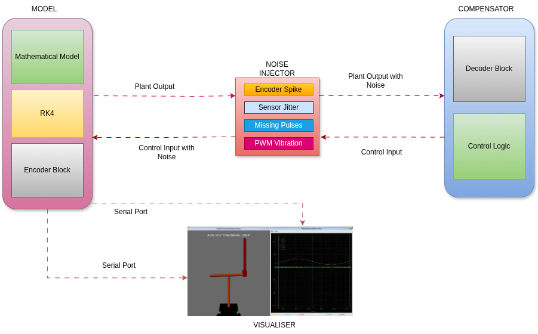
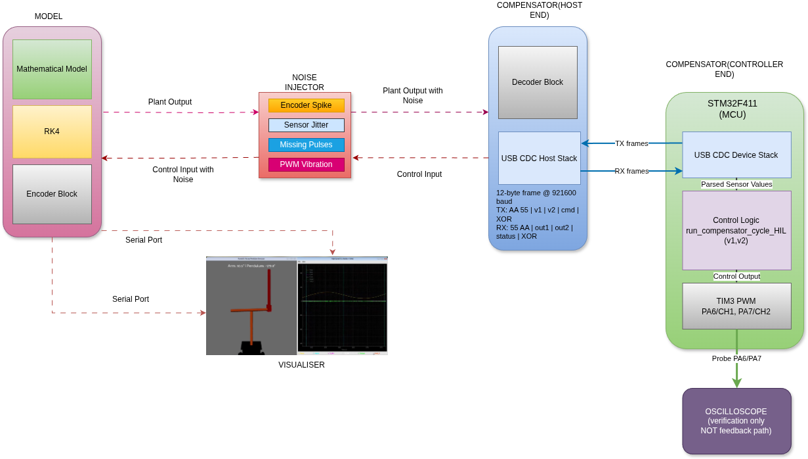

/* 
Copyright (C) 2026 Diptopal Basu (embeddedfreedom)

This program is free software: you can redistribute it and/or modify
it under the terms of the GNU General Public License as published by
the Free Software Foundation, either version 3 of the License, or
(at your option) any later version.

This program is distributed in the hope that it will be useful,
but WITHOUT ANY WARRANTY; without even the implied warranty of
MERCHANTABILITY or FITNESS FOR A PARTICULAR PURPOSE.  See the
GNU General Public License for more details.

You should have received a copy of the GNU General Public License
along with this program.  If not, see <https://www.gnu.org/licenses/>.
*/

# Installation Manual and Architecture Overview: Modular Dynamics Control Suite (MDCS)

**Date:** November 2026

**Version:** 2.0

<div style="color: white; font-weight: bold; background: #b30000; padding: 15px; border: 2px solid #7a0000; border-radius: 8px; margin: 20px 0;">

**🐧 Linux Only — No Windows or macOS Support**

MDCS is built for **Linux Desktop environments only**. The core simulator uses `clock_nanosleep(CLOCK_MONOTONIC, ...)` and other Linux-specific system calls that are not available on Windows or macOS.

- **Tested on:** Linux Mint 21.3 / Ubuntu 22.04+
- **Not supported:** Windows (including WSL for HIL), macOS
- **If you are on Windows or macOS:** You will need a Linux VM or a separate Linux machine to build and run MDCS.

</div>

<div style="color: white; font-weight: bold; background: #1a5276; padding: 15px; border: 2px solid #0e3d5c; border-radius: 8px; margin: 20px 0;">

**🔧 Two Variants: SIL and HIL**

MDCS ships with two build variants for every model:

| Variant                        | What it means                                             | Hardware needed  | Best for                             |
| ------------------------------ | --------------------------------------------------------- | ---------------- | ------------------------------------ |
| **SIL** — Software-in-the-Loop | Physics + compensator run together on your PC             | None             | Learning, testing control laws       |
| **HIL** — Hardware-in-the-Loop | Physics on PC; compensator on real STM32F411 over USB CDC | STM32F411E-DISCO | Validating on real embedded hardware |

**Start with SIL.** It requires no hardware and works immediately. Move to HIL only when you want to run the compensator on the actual chip.

- **SIL setup:** §4 Installation & Setup → §5 Execution  
- **HIL setup:** §6 Hardware-in-the-Loop (HIL)

</div>

**Executive Summary & Configuration:** This document serves as the installation and configuration manual and the architecture overview document for the MDCS simulation environment. It details the setup of the 20kHz simulation engine, the 1kHz compensator interface, and the virtual serial bridge configuration required for real-time visualization and control. This repository contains a collection of independent, hardcoded dynamical models. This manual also details the setup required to bridge these C-based simulations to the Python visualizers via virtual serial ports. 

> **Project status (v2.0):** MDCS is stable and feature-complete. It is maintained as needed — bug fixes, documentation corrections, and build compatibility — but no new models or features are planned. Issues and questions are welcome; responses may take time.

### 🚀 Quick Start & Live Demo

Before setting up the local environment, you can explore the system architecture and see the controllers in action via the official project resources:

- **Dashboard:** [embeddedfreedom.dev](https://www.embeddedfreedom.dev) — *A web-based overview of the MDCS models, system specifications, and ecosystem positioning.*

- **Video Walkthrough:** [MDCS Setup & Demonstration (v1.x — SIL only)](https://youtu.be/eaQ9mskr6E8) — *A 7-minute text-card walkthrough with soft background music (no narration), covering the SIL loop, telemetry plotter interaction, and 3D OpenGL visualization. HIL is covered in §6; flywheel and furnace details are in each model's README.*

## What's new in v2.0

| Addition                       | Details                                                                                                                                          |
| ------------------------------ | ------------------------------------------------------------------------------------------------------------------------------------------------ |
| **Hardware-in-the-Loop (HIL)** | STM32F411E-DISCO (Discovery kit) over USB CDC at 921600 baud. Fixed 12-byte frames with XOR checksums. See §6 for build, flash, and pin mapping. |
| **Flywheel with DC Motor**     | Position and speed profiles, 20-bit quadrature encoder, Z-pulse drift compensation at revolution boundaries.                                     |
| **Furnace Control**            | 2×2 coupled thermal LQI, dual PWM outputs (TIM3 CH1/PA6, CH2/PA7), industrial and bench parameter sets.                                          |
| **Automation**                 | `run_sim.py --hil` and `--hil-no-flash` for build → flash → run pipeline per model. See §9 for usage.                                               |

## Engineering notes

Six short write-ups of problems that were actually hit during development: symptom, diagnosis, fix, and scope of the fix. Written for anyone debugging the same failure.

| Note                                                                           | Problem                                                                                               |
| ------------------------------------------------------------------------------ | ----------------------------------------------------------------------------------------------------- |
| [Float precision in a slow plant](docs/notes/01-float-precision-slow-plant.md) | A thermal model heats but never cools, because a 20 kHz step is smaller than a `float` ULP.           |
| [Fixed-rate timing on Linux](docs/notes/02-fixed-rate-timing-and-jitter.md)    | Why relative sleeps drift, how absolute deadlines fix it, what the jitter alert measures.             |
| [The 12-byte HIL frame](docs/notes/03-hil-frame-protocol.md)                   | Sync hunting, XOR checksums, a 3 ms poll deadline, and what happens when the host stops sending.      |
| [Float-only compensator port](docs/notes/04-bare-metal-float-only-port.md)     | How a `double` reaches the firmware, and the three linker checks that catch it.                       |
| [HIL scope](docs/notes/05-what-hil-validates.md)                               | What the hardware tests prove, and what they do not.                                                  |
| [Lockstep HIL](docs/notes/06-lockstep-host-owns-the-clock.md)                  | Why the host owns the clock, and how plant and controller stay in phase when Linux preempts the host. |

Index: [`docs/notes/README.md`](docs/notes/README.md)

## 1. Architecture Overview

MDCS provides a **Real-Time (Soft) Hardware-Emulated environment—a Software-in-the-Loop (SIL) Digital Twin and also HIL running on STM32F411** that faithfully models a system using Lagrangian mechanics and the RK4 solver. Unlike theoretical scripts, this is designed to be interacted with as if it were a real plant sitting on your desk. It utilizes C, the industry standard for embedded systems, ensuring the transition from simulation to real hardware is seamless.

To enrich the student experience further, the project includes a **High-Fidelity 3D Visualizer** and **Real-Time Telemetry Graphs**. By mimicking noisy feedback and hardware signals, a bench-like environment is provided that challenges you to solve real-world problems like sensor jitter and encoder drift.

The framework is completely **configurable**; you can tweak the system specs and noise levels directly in the source code. Since the core executable is only **~20 KB** (minus the visualizers and the external shared libraries), it's incredibly lean. By writing your compensator in **native C**, you get a real feel for how industrial control actually works—managing **fixed-step timing** and **deterministic loops** rather than just dragging blocks in a GUI.

The **core physics engine** is optimized for single-thread execution to ensure deterministic timing, mirroring bare-metal microcontroller behavior. Meanwhile, the **visualization layer** utilizes asynchronous threading to handle UI rendering without blocking the 20kHz data stream. This decoupled architecture ensures high-fidelity physics even when running on standard consumer-grade x86 hardware without the overhead of heavy simulation suites.

The SIL project is built for **Linux Desktop** environments and utilizes a **high-precision timing super-loop** to emulate a **Real-Time (Soft)** bare-metal microcontroller environment. To mitigate general-purpose OS jitter, the framework employs a **lockstep architecture** where the physics solver and compensator are synchronously coupled; if the OS introduces a scheduling delay, the entire simulation state remains frozen to preserve **temporal determinism**. The system implements a **self-healing absolute timeline** that automatically corrects for OS-induced blocking to prevent cumulative timing drift against the wall clock, maintaining seamless visual realism regardless of background CPU load.

> **Split-rate design note:** The physics loop runs at 20 kHz while the compensator runs at 1 kHz (every 20 physics steps). Because the compensator rate (1 ms) is much faster than all plant time constants (e.g., τ ≈ 1055 s for the furnace), the plant can be treated as continuous between compensator updates for every model. This allows gain design using **continuous algebraic Riccati equation (CARE)** rather than requiring discrete algebraic Riccati equation (DARE) discretization — the continuous-time gains apply directly at the 1 kHz cadence.



_**SIL Architecture**: Software-in-the-Loop environment. The compensator and plant model run together on the host PC; no physical MCU is involved._



_**HIL Architecture**: Hardware-in-the-Loop architecture. The host simulator connects to a physical STM32F411E-DISCO over USB CDC at 921600 baud; the MCU runs the compensator law and the host runs the plant._

The same compensator code that runs in SIL is flashed to the STM32F411 and executes bare-metal at 1 kHz. Host and MCU exchange fixed **12-byte frames** with XOR checksums at 921600 baud — host→MCU carries sensor values (angles/temperatures), MCU→host returns control efforts (PWM/voltage). Measured host↔MCU↔host round-trip is **≈ 0.4 ms**, well inside the 3 ms poll timeout, so USB does not limit the 1 kHz compensator cadence. This lets you validate control performance on real silicon before deploying to hardware. See §6 Hardware-in-the-Loop (HIL) for build, flash, and run instructions.


#### 1.1 Modeling Fidelity & Abstractions

Bridging the digital-to-physical gap with intentional modeling choices:

##### Actuator (PWM)

Utilizes a **Mean Value Model**. The compensator returns a normalized duty cycle. At a 20:1 physics-to-control ratio, the plant's inertia acts as a natural low-pass filter, validating this approach for rigid-body simulation.

##### Sensors (Encoders)

Explicitly modeled as **Discrete Quadrature Pulses (A/B)**. This forces the compensator to manage quantization error and velocity jitter. Absolute positioning is verified via **Z-Index** latching at the **0° (Down)** reference point.

| Model | Encoder | CPR | Velocity quantum (1 kHz) |
|-------|---------|-----|--------------------------|
| Furuta | Quadrature (4x) | 4096 | ~1.53e-3 rad |
| Pendulum | Quadrature (4x) | 4096 | ~1.53e-3 rad |
| Flywheel | 20-bit | 1,048,576 | ~5.99e-6 rad |

The finer resolution on the flywheel gives much finer velocity resolution; the furuta/pendulum encoders have coarser quantization noise that the compensator low-pass filter must handle.

##### Motor Electrical Braking

When PWM is set to 0 (compensator disabled with **`T`**), the DC motor model can either **coast** (motor terminals float, no electrical braking) or **electrically brake** (back-EMF drives current through motor resistance, dissipating kinetic energy quickly).

Controlled via the `motor_coast_on_zero` parameter in each model's `Params` struct:

| Value | Behavior | Matches |
|-------|----------|---------|
| `true` (default) | Motor floats when PWM=0, no back-EMF braking | Most H-bridge motor drivers; real hardware coasts |
| `false` | Electrical braking when PWM=0 | Drives with active short-circuit braking |

**Default is `true`** for all models (furuta, pendulum, flywheel) to match typical real hardware behavior where the motor coasts when power is cut. Set to `false` if your driver actively shorts the motor terminals at zero PWM.


#### Furnace quick mode vs bench mode

The furnace simulator has two parameter sets:

| Mode | C1 | C2 | Use |
|------|-----|-----|-----|
| Industrial | 500 | 450 | Realistic slab thermal mass; τ ≈ 1055 s. Slow heating/cooling. |
| Bench | 5 | 4.5 | Small benchtop slab; τ ≈ 1.6 s. Fast settling (~7-8 s). |

Select via `BENCH_TEST_ACCELERATED` in `furnace_sim.c` (1 = bench, 0 = industrial). Bench mode divides `C1`/`C2` by 100 (500→5, 450→4.5) so the same thermal law settles in seconds (~7–8 s to reach 75 °C) rather than ~18 minutes — a speed-up for visualization and verification of the compensator without waiting for the slow industrial plant. The industrial plant's freeze under `float` is avoided by integrating `ThermalState` in `double`, not by bench mode; see `models/furnace_control/simulator/furnace_sim.c` above `rk4_step()`.


#### Flywheel position vs speed profiles

Two separate HIL/SIL profiles:

| Profile | Compensator | Setpoint | Notes |
|---------|-------------|----------|-------|
| Position | LQI | 23° angle | Steps to a target angle; ~8 s settle, ~8° overshoot |
| Speed | PI + feedforward | 15 rad/s | Regulates rotational velocity; ~26 s time constant |

Build/run separately: `make position` / `make speed` (SIL), `make -f Makefile_HIL position` / `speed` (HIL). Outputs go to `build/flywheel_control/position/` and `build/flywheel_control/speed/` respectively.


### ⚠️ CRITICAL OPERATIONAL LIMITATION

The `socat` configuration used in this suite creates a specific set of virtual serial bridges. This setup only accommodates **one** active control suite at a time.

- **Do not run two models simultaneously.**

- Attempting to run a second model (e.g., running `inverted_pendulum_sim` while `furuta_sim` is active) will result in serial port resource conflicts and data corruption.

<div style="color: red; font-weight: bold; background: #ffe6e6; padding: 15px; border: 2px solid red; border-radius: 8px; margin: 20px 0;">

**⚠️ WARNING — Centralised path config (edit before building)**

All machine-specific paths (socat PTY links, HIL serial port, HIL test port) are now defined in a single location:

**`framework/common/mdcs_config.h`** — the source of truth, read by every C simulator and `compensator_hil.c`.

It is mirrored (auto-generated) into:

- **`framework/common/mdcs_config.py`** — imported by every `run_sim.py` and Python visualiser.
- **`framework/common/mdcs_config.sh`** — sourced by `scripts/socat_bridges.sh`.

**Before building/running, edit `framework/common/mdcs_config.h` to match your machine/user, then run:**

```
python3 scripts/gen_mdcs_config.py
```

**You only need to run this once after each path change** — it regenerates the `.py` and `.sh` so C, Python and shell stay in sync automatically. There is nothing else to change — no more per-file path edits in `simulator/*.c`, `run_sim.py`, `compensator_hil.c` or the visualisers.

**If you do not update these, the simulator will write telemetry to the wrong PTY files, the Python visualizers will read from the wrong serial ports, and nothing will appear to work.**

The paths must match **exactly** between:

1. The `socat` commands you run (use `scripts/socat_bridges.sh`),
2. The C source files (simulator/compensator),
3. `run_sim.py` for your chosen model, and
4. The Python visualizer files.

Because all four now read from `mdcs_config.*`, editing `framework/common/mdcs_config.h` + re-running the generator keeps them in sync automatically.

</div>

## 2. Prerequisites

### System Dependencies

- **Any modern Linux distribution** (**tested: Linux Mint 21.3 / Ubuntu 22.04+ equivalents**)

- **Python 3.x***

- **GCC** (Build Essentials)

- **socat**: Virtual serial port utility.

**bash**

```
sudo apt update && sudo apt install socat
```

- **User permissions:** add your user to the `dialout` group so the HIL host can open `/dev/ttyACM0` without `sudo`:

**bash**

```
sudo usermod -a -G dialout $USER
```

Log out and back in for the group change to take effect.

### Environment & Python Packages

It is highly recommended to use **Conda** or **Python 3 venv** to prevent dependency conflicts.

Bash

```
# Setup venv
python3 -m venv venv
source venv/bin/activate

# Install required packages
pip3 install pyserial numpy pyside6 pyqtgraph pygame PyOpenGL PyOpenGL-accelerate
```

---

## 3. Project Structure

The project is organized into modular directories. For specific mathematical proofs, control theory diagrams, and stability analysis, refer to the **`docs/`** folder inside each model directory.

**📁 models/[model_name]/**

Each experimental setup (e.g., rotary_inverted_pendulum) contains the following sub-directories:

- **`compensator/`**:  Contains the actual control law and signal processing logic. This is the primary area for student modification.

- **`simulator/`**: The core physics engine. It runs at **20kHz** to ensure high-fidelity integration and numerical stability.

- **`visualiser/`**: Includes the 1kHz real-time plotter and the OpenGL 3D rendering environment.

- **`docs/`**  :This folder contains the theoretical foundation of the project:
  
  - **`Model Derivations:`** Full Lagrangian or Newtonian derivations of the equations of motion (EOM) for each system.
  
  - **`Design Diagrams:`** Includes the **System Block Diagrams**. These visualize the control architecture, showing how sensor data is filtered, passed through the compensator, and converted into actuator commands (Torque/Voltage).
   > **💡 Viewing Tip:** The `.md` derivation files contain **LaTeX source code** (`$...$` inline math with LaTeX commands like `\frac`, `\sin`, `\cos`, `\theta`). They render as formatted equations only in a Markdown renderer with math support. In **MarkText** (https://marktext.app/), they display as formatted equations. In a plain text editor or standard Markdown viewer without math support, they appear as literal dollar signs with backslash commands (e.g., `$x_3 = \frac{L_2}{2}\cos\theta_1$`).

- **`Makefile`**: Every model folder includes a Makefile. Run `make` to compile the compensator and simulator into a single executable binary. The flywheel is multi-profile: use `make position` or `make speed` instead of a plain `make`.

- **`Makefile_HIL`**: (All models) Builds the Hardware-in-the-Loop host executable plus STM32F411 firmware. Requires a physical MCU on `/dev/ttyACM0`.

**📁 build/  :** Contains the binary for the plant after compiling. This directory has subdirectories with the respective model names under which the compiled binaries get created after make.

**📁 framework/  :** This contains common utilities like the encoder and decoder for the Quadrature pulses (in the codecs directory) and the keypress detect (in the common directory) applications.

**📁 hil/hil_STM32F4/**: Shared HIL firmware engine for STM32F411. Provides the bare-metal USB CDC transport, TinyUSB stack integration, TIM3 PWM timer output, and the compensator adapter invoked by each model's MCU law. Model-specific MCU compensators are injected via `COMPENSATOR=<path>` from each model's `Makefile_HIL`.

**Supported Models:**

| Model                                                     | SIL (`make`)               | HIL (`make -f Makefile_HIL`)               | Notes                                                                       |
| --------------------------------------------------------- | -------------------------- | ------------------------------------------ | --------------------------------------------------------------------------- |
| Furuta (`rotary_inverted_pendulum`)                       | ✅                          | ✅                                          | Working reference — untouched. HIL outputs to `build/furuta/`.              |
| Pendulum (`pendulum_with_DC_motor`)                       | ✅                          | ✅                                          | Angle-only host→MCU link. HIL outputs to `build/inverted_pendulum/`.        |
| Flywheel (`flywheel_with_DC_motor/fixed_weight_flywheel`) | ✅ (`make position\|speed`) | ✅ (`make -f Makefile_HIL position\|speed`) | Multi-profile: separate position/speed MCU laws and build folders.          |
| Furnace (`furnace_control`)                               | ✅                          | ✅                                          | 2×2 thermal LQI, dual PWM outputs. HIL outputs to `build/furnace_control/`. |

> **⚠️ Flywheel nesting:** The flywheel model lives three levels deep:
> `models/flywheel_with_DC_motor/fixed_weight_flywheel/` — not `models/flywheel/`.
> Its HIL build outputs are split into two profile folders:
> `build/flywheel_control/position/` and `build/flywheel_control/speed/`,
> not a single `build/flywheel_control/`. Use `make position` or `make speed`
> (not plain `make`) for SIL builds.

--- 

---

### 🛠 Student Workflow

1. **Review the model's `docs/`**: Understand the mathematical model before touching the code.

2. **Modify `compensator/`**: Implement your control gains or logic.

3. **Compile**: Use the `Makefile` in the model root.

4. **Simulate & Visualise**: Launch the binary and use the Python tools to monitor performance.

### Gain Derivation (Python)

Design scripts and derivations for the LQR/LQI gains are kept with each model:

| Model    | Gain derivation                                                                                                                                                                            |
| -------- | ------------------------------------------------------------------------------------------------------------------------------------------------------------------------------------------ |
| Furuta   | Python LQR script in `models/rotary_inverted_pendulum/docs/Complete_derivation_Rotary_inverted_pendulum.md` §5 (Jacobian/linearization) and §6 (Numerical Implementation); reproduces all four checked-in gains |
| Pendulum | Python LQR script in `models/pendulum_with_DC_motor/docs/Complete_derivation_pendulum_DC_motor.md` §3 (LQR/Riccati) and §6 (Numerical Implementation); derives `k1`/`k2`, while `ki` is hand-tuned |
| Flywheel | `models/flywheel_with_DC_motor/fixed_weight_flywheel/docs/flywheel_lqi_design.py` and `docs/LQI_DERIVATION.md`, plus the per-profile calculators in `compensator/` (position gains match C; the speed PI is hand-tuned) |
| Furnace  | `models/furnace_control/docs/furnace_lqi_design.py` and `docs/LQI_DERIVATION.md`; matches both C copies                                                                                    |

---

## 4. Installation & Setup

#### Step 1: Initialise Serial Bridges

You must create virtual serial bridges to allow the C-based simulator to communicate with the Python visualizers.

Bash

```
# Use the helper script (reads paths from framework/common/mdcs_config.sh,
# which is generated from mdcs_config.h by scripts/gen_mdcs_config.py).
# Edit mdcs_config.h first if your PTY links live elsewhere, then:
#     python3 scripts/gen_mdcs_config.py
./scripts/socat_bridges.sh

# The script prints the four PTY links it created. Verify:
ls -l <sim_3d> <sim_graph>    # paths as set in framework/common/mdcs_config.h
```

Run `./scripts/socat_bridges.sh` once, in a terminal you leave open. This creates all four PTY links. If the bridges already exist, no need to re-run. This step must be started before starting the simulator, plotter or the visualiser. If not done, and the front end appears non-responsive, start the applications again.

**DO NOT CLOSE THE WINDOW WHERE THE socat COMMAND IS RUN. CLOSING THE WINDOW CLOSES THE BRIDGE. SO KEEP THE WINDOW OPEN FOR THE DURATION OF THE USE**

> 🔗 **See the red "Centralised path config" warning box at the top of this README** — edit `framework/common/mdcs_config.h` and run `python3 scripts/gen_mdcs_config.py` to set the socat PTY links, HIL serial port and HIL test defaults for your machine.

#### Step 2: Source Code Path Configuration

No per-file edits are needed. All paths are centralised in `framework/common/mdcs_config.h` (and its generated mirrors `mdcs_config.py` / `mdcs_config.sh`). Edit that single header to match your machine/user, then regenerate:

```
python3 scripts/gen_mdcs_config.py
```

Every simulator, `run_sim.py`, `compensator_hil.c`, Python visualiser, and `scripts/socat_bridges.sh` reads from it, so the socat PTY links, C source, Python visualisers and HIL serial port stay in sync automatically.

#### Step 2.5: Install ARM Cross-Toolchain (for HIL Firmware)

The HIL firmware for the STM32F411 is compiled with the ARM bare-metal cross-toolchain (`arm-none-eabi-gcc`). This is **only** required for HIL builds — SIL simulation compiles with the host `gcc` and needs no cross-toolchain.

See the full walkthrough: [MDCS Cross-Toolchain Install](https://youtu.be/2fNYTPCTxbg)

Bash

```
# Download the ARM GNU toolchain (example: ARM GNU Toolchain 13.3.Rel1)
wget https://developer.arm.com/-/media/Files/downloads/gnu/13.3.rel1/binrel/arm-gnu-toolchain-13.3.rel1-x86_64-arm-none-eabi.tar.xz

# Extract to /opt
sudo tar -xJf arm-gnu-toolchain-13.3.rel1-x86_64-arm-none-eabi.tar.xz -C /opt

# Add to PATH (permanent)
echo 'export PATH=/opt/arm-gnu-toolchain-13.3.rel1-x86_64-arm-none-eabi/bin:$PATH' >> ~/.bashrc
source ~/.bashrc

# Verify installation
arm-none-eabi-gcc --version
```

Expected output: `arm-none-eabi-gcc (GNU Toolchain for the Arm Architecture 13.3.rel1 ...)`

**Note:** The cross-toolchain is used by `Makefile_HIL` to compile the STM32F411 firmware (`MDCS_HIL.out/.bin`). SIL builds (`make`) use the host compiler and do not require it.

Flashing the resulting image is covered in [§6.3 Flashing Firmware](#63-flashing-firmware) — `st-flash` (the verified route), OpenOCD or STM32CubeProgrammer (both untested), or any tool of your choice, as long as the `.bin` lands at `0x08000000`.

#### Step 3: Compilation

Navigate to your chosen model directory and compile:

Bash

```
cd models/[model_name]
make
```

The resulting binary will be placed in the root `build/[model_name]` directory.

> **⚠️ Flywheel compilation:** The flywheel model is multi-profile. Run `make position`
> or `make speed` (not plain `make`) from inside
> `models/flywheel_with_DC_motor/fixed_weight_flywheel/`. Plain `make` will not work.

#### 4.4 Where Binaries Land and How to Run Them

All `make` commands are run from inside the model directory. Compiled binaries land in
`build/<model-dir>/` relative to the repo root. Run the simulator from inside the model
directory using a relative path up to `build/`:

| Model | Model directory | Build command | Binary (SIL) | Run from | Example run command |
|-------|----------------|---------------|--------------|----------|---------------------|
| Furuta | `models/rotary_inverted_pendulum/` | `make` | `build/furuta/furuta_sim` | model dir | `../../build/furuta/furuta_sim` |
| Pendulum | `models/pendulum_with_DC_motor/` | `make` | `build/inverted_pendulum/inverted_pendulum_sim` | model dir | `../../build/inverted_pendulum/inverted_pendulum_sim` |
| Furnace | `models/furnace_control/` | `make` | `build/furnace_control/furnace_sim` | model dir | `../../build/furnace_control/furnace_sim` |
| Flywheel position | `models/flywheel_with_DC_motor/fixed_weight_flywheel/` | `make position` | `build/flywheel_control/flywheel_position_sim` | model dir | `../../../build/flywheel_control/flywheel_position_sim` |
| Flywheel speed | `models/flywheel_with_DC_motor/fixed_weight_flywheel/` | `make speed` | `build/flywheel_control/flywheel_speed_sim` | model dir | `../../../build/flywheel_control/flywheel_speed_sim` |

HIL binaries and firmware land alongside SIL outputs:

| Model | HIL binary | HIL firmware | Example run command |
|-------|-----------|--------------|---------------------|
| Furuta | `build/furuta/furuta_sim_hil` | `build/furuta/MDCS_HIL.bin` | `../../build/furuta/furuta_sim_hil` |
| Pendulum | `build/inverted_pendulum/inverted_pendulum_sim_hil` | `build/inverted_pendulum/MDCS_HIL.bin` | `../../build/inverted_pendulum/inverted_pendulum_sim_hil` |
| Furnace | `build/furnace_control/furnace_sim_hil` | `build/furnace_control/MDCS_HIL.bin` | `../../build/furnace_control/furnace_sim_hil` |
| Flywheel position | `build/flywheel_control/position/flywheel_hil_sim` | `build/flywheel_control/position/MDCS_HIL.bin` | `../../../build/flywheel_control/position/flywheel_hil_sim` |
| Flywheel speed | `build/flywheel_control/speed/flywheel_hil_sim` | `build/flywheel_control/speed/MDCS_HIL.bin` | `../../../build/flywheel_control/speed/flywheel_hil_sim` |

Keys while running: `S` = enable compensator, `T` = disable, `Q` = quit.

---

## 5. Execution

##### **5.1** Binary Operation Manual

Start the simulator binary from inside the model directory using a relative path up to `build/` (see §4.4 for the full table of binary locations per model).

The simulator does not pass the "true" angle to the compensator. Instead, it converts the continuous physics angle into discrete **Gray Code states** (`phase_to_gray`).

- **Bus Logic:** The `EncoderBus` structure stores a sequence of transitions that occurred within the 1ms window.

- **Z-Pulse:** Emulates the physical index pulse of an encoder. When the pendulum passes the 0-degree mark (±0.1°), `bus.z_pend` is set to `true`, allowing the compensator to perform an absolute position reset.

#### Operational Controls

| **Key** | **Action**  | **Effect**                                                                           |
| ------- | ----------- | ------------------------------------------------------------------------------------ |
| **S**   | **Enable**  | Starts the compensator logic and applies motor power.                                |
| **T**   | **Disable** | Disconnects compensator from plant (`pwm = 0`); physics continue to run (free fall). |
| **Q**   | **Quit**    | Safely closes the simulation.                                                        |

 The model visualisers both graphical and the model will settle down like the real scenario. Pressing S again connects the compensator.  The output also displays timing jitter alerts if the control loop executes faster or slower than the expected interval of 1 millisecond. 

###### High-Precision Sync

The loop is governed by `clock_nanosleep` using the `CLOCK_MONOTONIC` timer. This ensures that the 50μs steps are consistent regardless of CPU load. A **Timing Jitter Alert** will print to the console if the 1kHz loop deviates by more than 5%.

#### 5.2 Telemetry Plotter Operational Manual

**Start the Plotter:** Run the Python script to see the system in action:

Bash

```
python3 visualiser/furuta_telemetry.py    # filenames vary by model, see the table below
```

The Telemetry plotter is a high-frequency (1kHz) data visualization and logging tool built with Python, PySide6, and PyQtGraph. Designed specifically for control systems engineering and hardware-in-the-loop implementation.

###### 5.2.1. Real-Time Visualization

- **Dual-Threaded Engine:** Data acquisition runs on a dedicated high-priority thread to prevent UI "freezing," ensuring the graph remains responsive even at 1000Hz.

- **GPU Acceleration:** Uses hardware-accelerated rendering. Instead of drawing 600,000 points, the engine "slices" the data to only render what is visible on your screen, maintaining a smooth 50 FPS.

- **Live Sync:** The graph automatically locks its X-axis to the latest incoming data packet.

###### 5.2.2. Interaction & Navigation

- **LIVE Mode:** By default, the graph auto-scrolls. You can zoom/scale the **Y-Axis** using the mouse wheel or right-click-drag to inspect signal amplitudes.

- **PAUSE Mode:** Click the "LIVE" toggle to pause. This unlocks the **X-Axis**, allowing you to scroll back through the 10-minute history buffer to find specific events.

- **Crosshair Tool:** Moving your mouse over the plot activates a high-precision crosshair. The tooltip displays the exact `Time (s)` and `Value` for the data point under your cursor.

- **Channel Toggles:** Individual channels can be turned on or off via checkboxes to reduce visual clutter during multi-variable analysis.

###### 5.2.3. Memory & Buffer Management

- **Circular History Buffer:** The plotter allocates a fixed block of memory for exactly **10 minutes** (600,000 samples at 1kHz for the furuta simulator). Use the **Clear Buffer** button between test runs to reset the timeline.

- **Zero-Latency Overwriting:** Once the 10-minute mark is reached, the oldest data is discarded to make room for new data. This allows the program to run for days without increasing RAM usage or slowing down.

- **Load Monitor:** The top-right overlay displays the real-time `Serial Rate (Hz)` and `Buffer %`. Use this to verify that your hardware is maintaining its target loop frequency.

###### 5.2.4. Data Export (CSV)

- **Snap-to-Zero Export:** When you click "Export CSV," the tool "unrolls" the circular buffer and reconstructs the last 10 minutes of data into a linear timeline.

- **Normalization:** The exported time column is automatically normalized to start at `0.0s`, making the data ready for immediate import into MATLAB, Excel, or Python for post-processing.

- **Safety Lock:** Export is disabled while in "LIVE" mode to ensure data integrity during the file-writing process.

###### 5.2.5. Unit Conversion

- **Radians/Degrees Toggle:** The plotter features a real-time conversion engine. Toggling this will instantly convert the angular data (Theta and Theta_Dot) on the fly without interrupting the data stream.

#### 5.3 3D System Simulator Operational Manual

Start the simulator: Run the Python script to see the system in action:

```bash
python3 visualiser/furuta_animation.py    # filenames vary by model, see the table below
```

##### 5.3.1. Architectural Overview

The simulator operates using a **Dual-Process Architecture** to ensure that communication bottlenecks do not interfere with smooth visual rendering:

- **The Serial Thread:** A background worker that continuously polls the serial port. It features an "auto-flush" mechanism (resetting the buffer if it exceeds 500 bytes) to prevent lag between the physical action and the 3D response.

- **The Render Loop:** Running at a locked 60 FPS, this process handles the OpenGL transformation pipeline and user input events.

###### 5.3.2. Coordinate System & Geometry

The simulator uses a standard **Right-Hand Coordinate System**:

- **X-Axis:** Horizontal across the lab table.

- **Y-Axis:** Vertical (Gravity vector).

- **Z-Axis:** Depth (Parallel to the motor shaft).

###### 5.3.3 Component Modeling:

Each model renders its own 3D assembly; the telemetry stream feeds the live angles/temperatures into the scene at 60 FPS:

- **Furuta (rotary inverted pendulum):** Hierarchical assembly — motor base (rendered as a `GL_QUADS` composite with 3D legs), vertical motor shaft, horizontal arm, and pendulum link. The arm rotates about the vertical axis by `theta_arm`; the pendulum inherits that rotation and rotates about its own **Z-axis** by `theta_pend` using `glRotatef(math.degrees(theta_pend), 0, 0, 1)`.

- **Pendulum with DC Motor:** Lab table (`GL_QUADS` top with four 3D legs), DC motor body, output shaft, and pendulum arm. The pendulum inherits the motor-shaft rotation and rotates about the **Z-axis** using `glRotatef(math.degrees(theta_pend), 0, 0, 1)`.

- **Flywheel with DC Motor:** Floor grid with coordinate axes and angular reference markers (double green bar = 0° DOWN, black bar = ±180° UP, red/blue ticks at ±90°), motor base body, drive shaft, and a red flywheel disk rotating about the **Z-axis** by `theta_flywheel`. A yellow alignment arrow tracks the 0° position and a shaded lighting model gives the flywheel a metallic sheen.

- **Furnace Control:** Insulated base slab (solid grey box), two coupled metal slabs (Zone 1 / Zone 2) drawn as gradient-colored boxes whose color maps to live temperature (cyan = ambient → yellow → red/white = hot), a contact line between the slabs, a heat-flux arrow over the thermal bridge proportional to `q12`, and a thermal convection particle plume that appears when either zone exceeds ambient by 10 °C. HUD shows `T1`, `T2`, `u1`, `u2`, `q12`, and `Tamb`.

###### 5.3.4. User Interface & Controls

The simulator includes a 2D heads-up display (HUD) overlaid on the 3D scene.

| **Action**        | **Control**          | **Description**                                           |
| ----------------- | -------------------- | --------------------------------------------------------- |
| **Rotate View**   | `Left-Click + Drag`  | Rotates the camera around the center of the table.        |
| **Zoom In/Out**   | `Right-Click + Drag` | Adjusts the camera distance (Z-translation).              |
| **Toggle Units**  | `T` Key              | Switches the HUD between Radians and Degrees.             |
| **Resize Window** | `Drag Corner`        | The viewport automatically adjusts the perspective ratio. |

**Script names by model** (run from inside the model directory):

| Model    | Telemetry plotter                            | 3D simulator                                 |
| -------- | -------------------------------------------- | -------------------------------------------- |
| Furuta   | `visualiser/furuta_telemetry.py`             | `visualiser/furuta_animation.py`             |
| Pendulum | `visualiser/motor_and_pendulum_telemetry.py` | `visualiser/motor_and_pendulum_animation.py` |
| Flywheel | `visualiser/motor_and_flywheel_telemetry.py` | `visualiser/motor_and_flywheel_animation.py` |
| Furnace  | `visualiser/furnace_telemetry.py`            | `visualiser/furnace_animation.py`            |

**NOTE:** The simulator and plotter can be started in any order, any one can also be started if the other is not required. This will not affect the visuals at all.

## 6. Hardware-in-the-Loop (HIL)

MDCS includes a complete Hardware-in-the-Loop implementation against a physical STM32F411 MCU over USB CDC at 921600 baud on `/dev/ttyACM0`. Only sensor values cross the link; the MCU derives velocity/state and runs the compensator law.

### 6.1 HIL Frame Format

Fixed **12-byte** frames with XOR checksum:

**Host→MCU:** `sync 0xAA 0x55 | float v1 | float v2 | uint8 cmd | uint8 checksum`

**MCU→host:** `sync 0x55 0xAA | float out1 | float out2 | uint8 status | uint8 checksum`

3 ms poll timeout per cycle.

| Model    | Host→MCU                                 | MCU→host                                                    |
| -------- | ---------------------------------------- | ----------------------------------------------------------- |
| Furuta   | arm angle, pendulum angle                | signed motor voltage (`out1`), pendulum angle echo (`out2`) |
| Pendulum | pendulum angle in `v1`, `v2 = 0`         | signed motor voltage in `out1`                              |
| Flywheel | wrapped flywheel angle in `v1`, `v2 = 0` | signed motor voltage in `out1`                              |
| Furnace  | measured `T1`, `T2`                      | PWM duty 1, PWM duty 2 (both `[0, 1]`)                      |

The shared adapter calls `run_compensator_cycle_HIL(v1, v2)` by default. With `-DHIL_TWO_OUTPUTS` (furnace only) it calls `run_compensator_cycle_HIL_dual(v1, v2, &out1, &out2)`; otherwise `out2 = v2`.

> **Where the frame is defined.** The canonical structs, sync bytes, command values, status bits, and XOR checksum helper live in `hil/hil_STM32F4/hil_protocol.h`. The firmware transport (`core_initialisation_STM32F411xe.h`, `usb_cdc_adapter.c`), all four host-side `compensator_hil.c` files, and the C lockstep test include it. Change the protocol there once and rebuild every HIL target; the `_Static_assert`s catch size/padding mistakes. The two Python test scripts still mirror the layout and must be updated separately if the wire format changes.

### 6.2 Building HIL

All HIL builds are run from inside the model directory:

| Model | Model directory | Build command | HIL host binary | HIL firmware | Notes |
|-------|----------------|---------------|-----------------|--------------|-------|
| Furuta | `models/rotary_inverted_pendulum/` | `make -f Makefile_HIL` | `build/furuta/furuta_sim_hil` | `build/furuta/MDCS_HIL.bin` | |
| Pendulum | `models/pendulum_with_DC_motor/` | `make -f Makefile_HIL` | `build/inverted_pendulum/inverted_pendulum_sim_hil` | `build/inverted_pendulum/MDCS_HIL.bin` | |
| Flywheel position | `models/flywheel_with_DC_motor/fixed_weight_flywheel/` | `make -f Makefile_HIL position` | `build/flywheel_control/position/flywheel_hil_sim` | `build/flywheel_control/position/MDCS_HIL.bin` | 3 levels deep |
| Flywheel speed | `models/flywheel_with_DC_motor/fixed_weight_flywheel/` | `make -f Makefile_HIL speed` | `build/flywheel_control/speed/flywheel_hil_sim` | `build/flywheel_control/speed/MDCS_HIL.bin` | 3 levels deep |
| Furnace | `models/furnace_control/` | `make -f Makefile_HIL` | `build/furnace_control/furnace_sim_hil` | `build/furnace_control/MDCS_HIL.bin` | Built with `-DHIL_TWO_OUTPUTS` |

Run all `make` commands from inside the listed model directory.

> **⚠️ Flywheel HIL nesting:** The flywheel model lives three levels deep:
> `models/flywheel_with_DC_motor/fixed_weight_flywheel/` — not `models/flywheel/`.
> Run the HIL build from inside that folder (`make -f Makefile_HIL position` or
> `make -f Makefile_HIL speed`). Outputs go to
> `build/flywheel_control/position/` and `build/flywheel_control/speed/` respectively —
> separate firmware images per profile.

### 6.2.5 Makefile Hierarchy & Build Mechanism

MDCS uses a two-level Makefile system. Each model directory contains its own `Makefile` (SIL) and `Makefile_HIL` (HIL), while the shared STM32F411 firmware engine lives in `hil/hil_STM32F4/`.

```
models/<model>/
├── Makefile                        # SIL build (host gcc)
├── Makefile_HIL                    # HIL build (host + invokes shared firmware)
├── simulator/                      # SIL physics engine (20 kHz RK4)
├── compensator/                    # Control laws
│   ├── compensator.c               # SIL law (float math)
│   ├── compensator_hil.c           # Host-side HIL link (USB CDC)
│   └── compensator_STM32F411.c     # MCU law (furnace names it compensator_hil_STM32F4.c)
├── visualiser/                     # Python 3D + telemetry
├── run_sim.py                      # Build + socat + simulator + visualizers
└── docs/                           # Derivations & diagrams
```

```
hil/hil_STM32F4/                    # Shared bare-metal firmware engine
├── Makefile                        # STM32F411 firmware (MIT licensed)
├── HIL_main.c                      # USB CDC task + compensator adapter
├── include/
│   └── tusb_config.h               # TinyUSB device configuration
├── src/
│   ├── core_initialisation_STM32F411xe.c   # Clock, GPIO, TIM3 PWM, USB
│   ├── startup_gcc.c                 # Vector table, reset handler
│   ├── UART.c                        # UART helpers
│   ├── printm.c                      # Bare-metal printf (LGPLv2.1)
│   ├── handlers_STM32F411xe.c        # IRQ handlers
│   ├── applications.c                # Main loop
│   ├── usb_descriptors.c             # USB CDC descriptors
│   └── usb_cdc_adapter.c             # 12-byte frame parser + dispatcher
└── MDCS_HIL.ld                       # Linker script (FLASH @ 0x08000000)
```

**TinyUSB stack** — The USB CDC transport is provided by the [TinyUSB](https://github.com/hathach/tinyusb) stack, vendored at `tinyusb-master/` and licensed under MIT. It is **not** part of MDCS itself — it is a third-party dependency kept under `tinyusb-master/`. The shared firmware Makefile (`hil/hil_STM32F4/Makefile`) pulls in only the subset of TinyUSB source files needed for device-mode CDC:

```make
TINYUSB_ROOT = ../../tinyusb-master

include_dirs = . include $(TINYUSB_ROOT)/src $(dir $(COMPENSATOR))

sources = HIL_main.c \
          src/core_initialisation_STM32F411xe.c \
          ...
          src/usb_descriptors.c \
          src/usb_cdc_adapter.c \
          $(COMPENSATOR) \
          $(TINYUSB_ROOT)/src/tusb.c \
          $(TINYUSB_ROOT)/src/common/tusb_fifo.c \
          $(TINYUSB_ROOT)/src/device/usbd.c \
          $(TINYUSB_ROOT)/src/class/cdc/cdc_device.c \
          $(TINYUSB_ROOT)/src/portable/synopsys/dwc2/dcd_dwc2.c \
          $(TINYUSB_ROOT)/src/portable/synopsys/dwc2/dwc2_common.c
```

The model's `Makefile_HIL` invokes this shared Makefile recursively, passing `COMPENSATOR` and `OUTPUT_DIR`. TinyUSB sources are compiled from `tinyusb-master/` directly — there is no separate build step for the stack.

**Build flow — SIL (`make`):**

The model's `Makefile` compiles the simulator (`simulator/<model>_sim.c`) + SIL compensator (`compensator/compensator.c`; flywheel uses `compensator/{position_control,speed_control}/compensator.c`) + `get_keypress.c` with host `gcc`. Output goes to `build/<model>/<model>_sim` (or `build/flywheel_control/flywheel_position_sim` / `flywheel_speed_sim`).

**Build flow — HIL (`make -f Makefile_HIL`):**

Two separate compilations happen:

1. **Host binary** — Compiled with host `gcc` from the simulator + `compensator/compensator_hil.c` (USB CDC link layer; flywheel uses `compensator/hil_control/compensator_hil.c`) + `get_keypress.c`. Outputs `build/<model>/<model>_sim_hil` (or `build/flywheel_control/{position,speed}/flywheel_hil_sim`).

2. **MCU firmware** — `Makefile_HIL` recursively invokes `hil/hil_STM32F4/Makefile`, passing:
   
   - `COMPENSATOR=<absolute path to model's MCU compensator .c file>`
   
   - `OUTPUT_DIR=<absolute path to model's build folder>`
   
   - Optional `EXTRA_CFLAGS` (e.g., `-DHIL_TWO_OUTPUTS` for furnace; the flywheel selects its profile by choosing the MCU source file)
   
   The shared firmware Makefile compiles STM32F411 bare-metal code (TinyUSB stack + clock + GPIO + TIM3 PWM + CDC adapter + model's compensator), links with `arm-none-eabi-gcc`, then `arm-none-eabi-objcopy` produces `MDCS_HIL.bin` for flashing at `0x08000000`.

**Key points:**

- **No `COMPENSATOR` hardcoded in shared firmware** — Each model's `Makefile_HIL` injects its own compensator. The shared `hil/hil_STM32F4/Makefile` requires `COMPENSATOR` to be set (errors out otherwise, except for `make clean`).
- **Single-precision only (MCU)** — `float` math, `fpv4-sp-d16` FPU, hard-float ABI. No `double`, no `M_PI`, no libm. Local `sqrt_pos()` Newton iteration replaces `sqrtf()`. All five MCU images link no soft-double or libm symbols; see §6.5.
- **Clean builds** — `make clean` removes the model's entire `build/` subtree (SIL + HIL together). For flywheel, both `position/` and `speed/` subfolders are removed.
- **Header changes** — Firmware rules list `.c` sources only; editing a `.h` does not force a rebuild. Use `make -B -f Makefile_HIL` or delete `MDCS_HIL.out` after header changes.

### 6.3 Flashing Firmware

> **Which of these has been tested?** Only **Option A (`st-flash`)**, which is also what `run_sim.py` uses. The OpenOCD and STM32CubeProgrammer commands in Options B and C follow the vendors' standard usage but have **not** been executed against this firmware — treat them as a starting point, and fall back to `st-flash` if one fails.

`Makefile_HIL` links and then converts the ELF to a raw binary:

```
build/<model>/MDCS_HIL.bin
```

Flash that file to the start of the STM32F411 flash, **`0x08000000`**. There is no bootloader offset — `startup_gcc.c` puts the vector table there via `MDCS_HIL.ld`.

Each model (and each flywheel profile) produces its own firmware because the compensator law is compiled in, so always flash the `.bin` that sits next to the host binary you are about to run:

| Model               | Binary to flash                                |
| ------------------- | ---------------------------------------------- |
| Furuta              | `build/furuta/MDCS_HIL.bin`                    |
| Pendulum            | `build/inverted_pendulum/MDCS_HIL.bin`         |
| Flywheel (position) | `build/flywheel_control/position/MDCS_HIL.bin` |
| Flywheel (speed)    | `build/flywheel_control/speed/MDCS_HIL.bin`    |
| Furnace             | `build/furnace_control/MDCS_HIL.bin`           |

#### Option A — `st-flash` (stlink-tools)

Works with the on-board ST-LINK of the Discovery kit and with a standalone ST-LINK dongle:

```bash
sudo apt install stlink-tools          # Debian/Ubuntu
st-flash --reset write build/<model>/MDCS_HIL.bin 0x08000000
```

#### Option B — OpenOCD (untested here)

```bash
openocd -f interface/stlink.cfg -f target/stm32f4x.cfg \
        -c "program build/<model>/MDCS_HIL.bin 0x08000000 verify reset exit"
```

On older OpenOCD releases the adapter config is named `interface/stlink-v2.cfg`. On most Linux systems OpenOCD needs permission to open the ST-LINK USB device — either run it under `sudo` or install the shipped udev rules (`/usr/share/openocd/contrib/60-openocd.rules`) and re-plug the board.

#### Option C — STM32CubeProgrammer (untested here)

The CLI is not on `PATH` by default on Linux; add STM32CubeProgrammer's `bin/` directory to `PATH`, use the full path, or launch it from the GUI terminal.

CLI:

```bash
STM32_Programmer_CLI -c port=SWD -w build/<model>/MDCS_HIL.bin 0x08000000 -Rst
```

GUI: connect over SWD (SWDIO, SWCLK, GND, 3V3), open the `.bin`, set the start address to `0x08000000`, then **Download**.

#### Option D — any other tool

The list above is just a starting point. `pyocd`, a J-Link, `dfu-util` (only if the ROM bootloader is enabled), or any programmer that can write a raw binary to an absolute address will all work. **Students are free to use whatever flashing tool they already know** — nothing in the firmware or in the host simulator depends on how the image gets onto the chip.

If your tool asks for an address, it is always `0x08000000`. If it asks for a format, the file is a raw `.bin`, not an ELF or a hex file (use `MDCS_HIL.out` if you want the ELF for debugging, `MDCS_HIL.bin` for flashing).

#### After flashing

- The board reboots and enumerates as a USB CDC device: `ls -l /dev/ttyACM0`.
- `dmesg | tail` should show the CDC ACM attach.
- The HIL host binary opens `/dev/ttyACM0` at 921600 baud, so the port must be free and the user must be in the `dialout` group.

If `/dev/ttyACM0` never appears, the usual cause is the clock setup: the firmware assumes an **8 MHz HSE** crystal. A board with a different crystal needs the PLL factors in `PLL_Init_84MHZ()` adjusted (see §6.6).

### 6.4 Running HIL

Start the socat bridges first (see Step 1 above), then run the HIL host binary. From a model directory two levels below the repo root (furuta, pendulum, furnace), the path is `../../build/<build_dir>/<hil_binary>`, using the build directories listed in §6.2:

```bash
../../build/furuta/furuta_sim_hil
../../build/inverted_pendulum/inverted_pendulum_sim_hil
../../build/furnace_control/furnace_sim_hil
```

The nested flywheel model is three levels deep, so its binaries are at:

```bash
../../../build/flywheel_control/{position,speed}/flywheel_hil_sim
```

Press **S** to enable the compensator, **T** to disable, **Q** to quit.

**Link behaviour (measured on hardware; all models, including both flywheel profiles, have been run in HIL on the STM32F411):** one host→MCU→host exchange costs **≈ 0.4 ms** (0.32–0.50 ms over five requests at 921600 baud), far inside the 3 ms `poll()` timeout, so USB does not limit the 1 kHz compensator cadence. Normal runs report no `CONNECTION ERROR` lines.

For the furnace model, probing the compensator code on the MCU directly, with setpoints 75/75 °C, shows the law running on the chip and not on the host (table below):

| Sent T1 / T2 | PWM1 / PWM2 returned | Why                                                       |
| ------------ | -------------------- | --------------------------------------------------------- |
| 25.0 / 25.0  | 1.0000 / 1.0000      | 50 °C below setpoint — `Kx ≈ 20.8` saturates both heaters |
| 74.0 / 74.0  | 1.0000 / 1.0000      | 1 °C below setpoint is still enough to saturate           |
| 75.0 / 75.0  | 0.8333 / 0.7454      | zero error → exactly the feedforward `pwm_sp`             |
| 76.0 / 76.0  | 0.0000 / 0.0000      | above setpoint → heaters off                              |

Every reply carried `status = 0x01` (running) and a valid XOR checksum.

> **Setpoint changes:** The furnace heater model is nonlinear (`P = V²/R`), so the LQI gains are valid only near their linearization point (75/75 °C). Changing setpoints requires recomputing gains via `docs/furnace_lqi_design.py` — see §17 "Nonlinear plant — setpoint changes require gain recomputation" in `models/furnace_control/docs/LQI_DERIVATION.md`.

**MCU integrator cadence:** the MCU law keeps no clock of its own. Each frame it receives advances the integral by a fixed `q += e * 0.001f`, i.e. it assumes exactly one host call per millisecond. The host calls the compensator once per 20 physics steps (1 kHz), so the two rates agree as long as the host loop meets its deadline. If the host falls behind, the integral simply advances more slowly in wall time — invisible at τ ≈ 1000 s, but do not change the host cadence without also changing that `0.001f`.

### 6.4.1 Host-side link test (`host_HIL_test`)

`hil/hil_STM32F4/test/host_HIL_test.c` is a standalone **transport** test, not a control-law test. It sends synthetic frames at 1 kHz for 1000 cycles and verifies each reply:

| Check                                         | Catches                    |
| --------------------------------------------- | -------------------------- |
| Sync is `0x55 0xAA` (or raw echo `0xAA 0x55`) | byte slip / framing errors |
| XOR checksum matches                          | corrupted or dropped bytes |
| `out1` / `out2` are finite                    | broken float transfer      |
| `abs(out1), abs(out2) ≤ 50`                   | grossly implausible values |

It does **not** compare outputs to inputs or validate gains — the MCU runs the real compensator, so the outputs are control efforts. The synthetic inputs are fixed sinusoids (`1.25·sin`, `-0.75·cos`), so for the furnace they look like temperatures far below setpoint and both PWMs saturate at `1.0`.

Build and run:

```bash
cd hil/hil_STM32F4/test
gcc -O2 host_HIL_test.c -o host_HIL_test -lm
./host_HIL_test /dev/ttyACM0      # omit the argument to use MDCS_HIL_TEST_PORT
```

`MDCS_HIL_TEST_PORT` (default `/dev/ttyUSB0`) is separate from `MDCS_HIL_PORT` (default `/dev/ttyACM0`): the test can be pointed at a USB-to-serial adapter, while the simulators use the board's CDC port.

**When it goes stale:** adding a model or changing gains, setpoints, or plant parameters requires no change. Changing the frame size/layout, sync bytes, checksum, or command/status bits is a single edit in `hil_protocol.h`; changing the baud rate, loop cadence, or timeout still requires editing the test itself. The two Python test scripts mirror the frame layout separately. The exit status reflects only sync and checksum errors; timeouts, NaN/Inf, and range violations are counted in the summary but do not make the process fail.

### 6.5 Bare-Metal Firmware Rules

MCU code must stay fully bare-metal: no `-lm`, no newlib syscalls, single-precision FPU only.

- No `double`, no `M_PI` (it is a `double` in `math.h`), no unsuffixed decimal literals, no libm calls.
- Use local float `PI` and `fabsf`.
- Firmware rules list `.c` sources only — after editing a header, force a rebuild with `make -B -f Makefile_HIL` or delete `MDCS_HIL.out`.
- `EXTRA_CFLAGS` is not a make dependency; stale firmware can persist if defines change without cleaning.

**Verified:** all five MCU images (furuta, inverted_pendulum, flywheel position/speed, furnace_control) rebuilt with `make -B -f Makefile_HIL` contain no undefined `__aeabi_d*`, `sqrt`, `fabs`, `sin`, or `cos` symbols. Furuta and pendulum include `<math.h>` and call `fabsf`, which GCC lowers to a single-precision instruction, so the float-only rule holds for every model.

### 6.6 Board & Clock Configuration

**Reference hardware: the STM32F411E-DISCO Discovery kit**, which carries an **8 MHz HSE crystal**. Every HIL measurement in this document was taken on that board.

The clock tree is configured in:

- `hil/hil_STM32F4/core_initialisation_STM32F411xe.h`
- `hil/hil_STM32F4/src/core_initialisation_STM32F411xe.c`

The 8 MHz value is baked into `PLL_Init_84MHZ()`: `PLLM = 4` gives a 2 MHz VCO input, `PLLN = 168` gives a 336 MHz VCO, `PLLP = /4` gives 84 MHz SYSCLK and `PLLQ = /7` gives the 48 MHz USB clock. A board with a different HSE crystal will not run this image as-is. The PLL input must land in 1–2 MHz and the VCO in 100–432 MHz, so most other crystals put the PLL outside its operating range; and even when they do not, SYSCLK and the 48 MHz USB clock come out at the wrong frequency. In either case the board looks dead and `/dev/ttyACM0` never appears — there is no error message.

#### PLL values

| Board              | HSE    | `PLLM` | `PLLN` | `PLLP` | `PLLQ` | SYSCLK | USB    | Status                  |
| ------------------ | ------ | ------ | ------ | ------ | ------ | ------ | ------ | ----------------------- |
| STM32F411E-DISCO   | 8 MHz  | `4U`   | `168U` | `/4`   | `/7`   | 84 MHz | 48 MHz | Run on hardware         |
| Blackpill (F411CE) | 25 MHz | `25U`  | `336U` | `/4`   | `/7`   | 84 MHz | 48 MHz | Derived only — untested |

**The Blackpill row is arithmetic, not a tested build.** No Blackpill has been run with this project, and the 25 MHz figure comes from the vendor's schematic rather than from a board measured here. It follows from the RM0383 limits (`f(VCOin) = f(HSE) / PLLM` inside 1–2 MHz, `f(VCO) = f(VCOin) × PLLN` inside 100–432 MHz): `25/25 = 1 MHz` → `× 336 = 336 MHz` → `/4 = 84 MHz` → `/7 = 48 MHz`. Verify the crystal on your own board's schematic and confirm the constants before relying on them.

Button polarity, LED pins, bootloader/ST-LINK arrangement and flash/SRAM size also differ between boards, and none of that has been validated here.

`SystemCoreClock` stays `84000000U` and flash latency stays 2 wait states as long as the 84 MHz target is kept. `HSE_VALUE` is not defined or used in this project, so there is no CMSIS constant to update.

Verify the target crystal before building; an 8 MHz HSE is assumed by default.

Porting to an unrelated board also requires checking:

- Any board-specific GPIO/pin assignments in `TIM3_PWM_Init()` and `usb_hardware_init()`
- Linker script memory regions (`MDCS_HIL.ld`) if flash/SRAM sizes differ

#### TIM3 PWM Pin Assignment

The STM32F411 firmware uses TIM3 for hardware PWM output. Pin assignments:

| Model               | Timer | Channel | Pin | Alternate Function | Output               |
| ------------------- | ----- | ------- | --- | ------------------ | -------------------- |
| Furuta              | TIM3  | CH1     | PA6 | AF2                | Signed motor voltage |
| Pendulum            | TIM3  | CH1     | PA6 | AF2                | Signed motor voltage |
| Flywheel (position) | TIM3  | CH1     | PA6 | AF2                | Signed motor voltage |
| Flywheel (speed)    | TIM3  | CH1     | PA6 | AF2                | Signed motor voltage |
| Furnace             | TIM3  | CH1     | PA6 | AF2                | Heater 1 PWM duty    |
| Furnace             | TIM3  | CH2     | PA7 | AF2                | Heater 2 PWM duty    |

**Note:** All models use TIM3. The furnace uses both TIM3_CH1 (PA6) and TIM3_CH2 (PA7) for its two independent heater PWMs. TIM4 is **not** configured for PWM output in any model — it only appears in the interrupt vector table as an unused default handler.

**Scope check vs USB CDC link:** The PWM pins (PA6/PA7) output the PWM duty cycle on the STM32 and can be probed with an oscilloscope or multimeter to verify the firmware is generating the expected signal. However, in the HIL setup the actual control values are sent back to the host over USB CDC (the 12-byte frame, 921600 baud) — the PWM pins are for hardware verification only, not the primary feedback path.

## 7. System Specifications & Logic

- **Timing:** 20kHz Simulation Loop | 1kHz Compensator.

- **Coordinates:** $0$ is Down (stable), $\pi$ (or $180^\circ$) is Up (unstable).

- **Convention:** Clockwise turns are **negative**; Counter-clockwise are **positive**.

- **Arm Range (Furuta):** $0$ to $\pm 180^\circ$.

- **Data Format:** Tab-delimited fixed-precision ASCII stream. Each model has its own value set: Furuta sends a 6-value packet (Value 1 = arm angle, Value 2 = pendulum angle, then their rates, torque and commanded voltage); pendulum, flywheel and furnace streams are documented in their model READMEs.

- **UI:** The visualizer includes a toggle to switch between Radians and Degrees.

## 8. License

MDCS uses multiple licenses depending on the component:

| Component                                                                 | License  | File                    |
| ------------------------------------------------------------------------- | -------- | ----------------------- |
| Documentation (READMEs, `AGENTS.md`, `docs/*.md`, `docs/*.pdf`, diagrams) | GPLv3    | `LICENSE-GPLv3`         |
| All model source (`*.c`, `*.h`, `*.py`, `Makefile`, `Makefile_HIL`)       | GPLv3    | `LICENSE-GPLv3`         |
| Framework (`framework/`)                                                  | GPLv3    | `LICENSE-GPLv3`         |
| HIL shared firmware (`hil/hil_STM32F4/`)                                  | MIT      | `LICENSE-MIT`           |
| MCU compensators (`compensator_STM32F411.c`)                              | MIT      | `LICENSE-MIT`           |
| `tinyusb-master/` (vendored stack)                                        | MIT      | `tinyusb-master/`       |
| `printm.c` (printf implementation)                                        | LGPLv2.1 | `LICENSES/LGPL-2.1.txt` |

- **`LICENSE-GPLv3`** — GPLv3, the primary license for MDCS source code and documentation.
- **`LICENSE-MIT`** — MIT License, applies only to HIL firmware and MCU compensator files.
- **`LICENSES/LGPL-2.1.txt`** — GNU Lesser General Public License v2.1, applies to `hil/hil_STM32F4/src/printm.c`.
- **`tinyusb-master/`** — Vendored third-party stack, licensed under MIT (see `tinyusb-master/` source headers).

## 9. Quick Run with `run_sim.py`

Each model folder includes a `run_sim.py` script that automates: **build → flash → socat bridges → simulator → visualizers**. Run it from inside the model directory.

### Usage

Navigate to the model directory and run:

```bash
python3 run_sim.py           # SIL build + run
python3 run_sim.py --hil     # HIL build + flash MCU + run
python3 run_sim.py --hil-no-flash  # HIL build + run, skip flashing (flash MCU yourself first)
python3 run_sim.py --help    # Show usage help
```

For flywheel (multi-profile), specify the profile:

```bash
python3 run_sim.py position           # SIL position build + run
python3 run_sim.py speed              # SIL speed build + run
python3 run_sim.py --hil position     # HIL position build + flash + run
python3 run_sim.py --hil speed        # HIL speed build + flash + run
python3 run_sim.py --hil-no-flash position   # HIL position build + run, skip flashing
python3 run_sim.py --hil-no-flash speed      # HIL speed build + run, skip flashing
python3 run_sim.py --help             # Show usage help
```

### What the script does

1. **Builds** the model (always rebuilds — host binary for SIL, host + firmware for HIL)
2. **Flashes firmware** to STM32 via `st-flash` (HIL mode with `--hil` only; skipped with `--hil-no-flash`)
3. **Creates socat bridges** (PTY links from `framework/common/mdcs_config.h`) if they don't already exist
4. **Launches the simulator binary** (SIL or HIL)
5. **Launches both visualizers** (3D animation + telemetry plotter)
6. **Runs in foreground** until you press `Ctrl+C`
7. **Cleans up** — kills all processes and socat bridges on exit

### Model-specific commands

| Model                   | Command (from inside model dir)                     | Output                                                         |
| ----------------------- | --------------------------------------------------- | -------------------------------------------------------------- |
| Furuta                  | `python3 run_sim.py`                                | `build/furuta/furuta_sim`                                      |
| Furuta HIL              | `python3 run_sim.py --hil`                          | `build/furuta/furuta_sim_hil` + firmware                       |
| Furuta HIL (no flash)   | `python3 run_sim.py --hil-no-flash`                 | `build/furuta/furuta_sim_hil` + firmware                       |
| Pendulum                | `python3 run_sim.py`                                | `build/inverted_pendulum/inverted_pendulum_sim`                |
| Pendulum HIL            | `python3 run_sim.py --hil`                          | `build/inverted_pendulum/inverted_pendulum_sim_hil` + firmware |
| Pendulum HIL (no flash) | `python3 run_sim.py --hil-no-flash`                 | `build/inverted_pendulum/inverted_pendulum_sim_hil` + firmware |
| Flywheel position       | `python3 run_sim.py position`                       | `build/flywheel_control/flywheel_position_sim`                 |
| Flywheel speed          | `python3 run_sim.py speed`                          | `build/flywheel_control/flywheel_speed_sim`                    |
| Flywheel HIL position   | `python3 run_sim.py --hil position`                 | `build/flywheel_control/position/` + firmware                  |
| Flywheel HIL speed      | `python3 run_sim.py --hil speed`                    | `build/flywheel_control/speed/` + firmware                     |
| Flywheel HIL (no flash) | `python3 run_sim.py --hil-no-flash position\|speed` | `build/flywheel_control/{position,speed}/` + firmware          |
| Furnace                 | `python3 run_sim.py`                                | `build/furnace_control/furnace_sim`                            |
| Furnace HIL             | `python3 run_sim.py --hil`                          | `build/furnace_control/furnace_sim_hil` + firmware             |
| Furnace HIL (no flash)  | `python3 run_sim.py --hil-no-flash`                 | `build/furnace_control/furnace_sim_hil` + firmware             |

### Controls during runtime

- **`S`** — Enable compensator (press in the simulator terminal)
- **`T`** — Disable compensator
- **`Q`** — Quit the simulator
- **`Ctrl+C`** — Stop the script and clean up all processes

### Important notes

- **HIL mode (`--hil`):** Builds host + firmware, flashes MCU via `st-flash`, then runs. Requires an STM32F411 on `/dev/ttyACM0` with `st-flash` installed. See [§6.3 Flashing Firmware](#63-flashing-firmware).
- **HIL no-flash (`--hil-no-flash`):** Builds host + firmware, skips flashing, then immediately launches the host simulator and visualizers. Flash `MDCS_HIL.bin` first with your own programmer (OpenOCD, STM32CubeProgrammer, J-Link, etc.); the script does not pause for you to flash before starting the HIL host.
- **Help (`--help`, `-h`):** Prints usage information and exits.
- **Socat bridges:** The script reuses existing bridges if they already exist; otherwise it creates new ones. You do not need to start socat manually.
- **Working directory:** Always run `run_sim.py` from *inside* the model directory.
- **Build:** Always rebuilds on every run — no need for `make clean` between changes.

---

## 10. Troubleshooting

This is **not an exhaustive list**. It covers the most common first-time issues; if your problem is not listed here, check the model-specific `README.md` and `AGENTS.md` in the model folder, or the `docs/notes/` write-ups referenced in §0.

### Symptom: Nothing appears in the visualizer / telemetry plotter

| Possible cause                 | Check / Fix                                                                                                                                                                                                                                      |
| ------------------------------ | ------------------------------------------------------------------------------------------------------------------------------------------------------------------------------------------------------------------------------------------------ |
| Socat bridges not running      | `ls -l <sim_3d> <sim_graph>` (paths from `mdcs_config.h`). If missing, run `./scripts/socat_bridges.sh` (or let `run_sim.py` create them).                                                                                                       |
| Paths don't match              | The PTY links in socat, C source files, `run_sim.py`, and the Python visualizers must all use the **exact same** paths. They are centralised in `framework/common/mdcs_config.h` — edit it and run `python3 scripts/gen_mdcs_config.py`. See §1. |
| Wrong model directory          | Run `run_sim.py` from **inside** the model directory (e.g. `cd models/rotary_inverted_pendulum && python3 run_sim.py`).                                                                                                                          |
| Simulator not producing output | Press **`S`** in the simulator terminal to enable the compensator. Without it, PWM is 0 and the plant may appear static.                                                                                                                         |

### Symptom: HIL host cannot open `/dev/ttyACM0` (permission denied)

| Possible cause                   | Check / Fix                                                                                                                                           |
| -------------------------------- | ----------------------------------------------------------------------------------------------------------------------------------------------------- |
| User not in `dialout` group      | `groups` should list `dialout`. If not: `sudo usermod -a -G dialout $USER`, then log out and back in.                                                 |
| Another process holding the port | Only one program can own `/dev/ttyACM0` at a time. Close other serial terminals, visualizers, or `screen`/`minicom` sessions.                         |
| Board not enumerated             | `lsusb` should show `cafe:4001 MDCS_HIL`. If missing, the board may not be flashed, the crystal may be wrong (see §6.6), or the cable/port is faulty. |

### Symptom: `make -f Makefile_HIL` fails with "arm-none-eabi-gcc: command not found"

| Possible cause                                     | Check / Fix                                                                                            |
| -------------------------------------------------- | ------------------------------------------------------------------------------------------------------ |
| ARM cross-toolchain not installed or not on `PATH` | Install `arm-none-eabi-gcc` (see §4 Step 2.5) and verify with `arm-none-eabi-gcc --version`.           |
| `PATH` not exported                                | Add `export PATH=/opt/arm-gnu-toolchain-13.3.rel1-x86_64-arm-none-eabi/bin:$PATH` to your `~/.bashrc`. |

### Symptom: Firmware changes don't take effect (header edited, rebuild seems ignored)

| Possible cause                           | Check / Fix                                                                                                        |
| ---------------------------------------- | ------------------------------------------------------------------------------------------------------------------ |
| Firmware Makefile tracks `.c` files only | Editing a `.h` does not force a rebuild. Run `make -B -f Makefile_HIL` or delete `MDCS_HIL.out` before rebuilding. |
| Stale `EXTRA_CFLAGS`                     | `EXTRA_CFLAGS` is not a make dependency. Clean (`make clean`) if defines changed.                                  |

### Symptom: Board flashes OK but `/dev/ttyACM0` never appears

| Possible cause       | Check / Fix                                                                                                                                                    |
| -------------------- | -------------------------------------------------------------------------------------------------------------------------------------------------------------- |
| Wrong HSE crystal    | Firmware assumes an **8 MHz HSE** (STM32F411E-DISCO). A different crystal breaks the PLL and USB clock — the board looks dead with no error message. See §6.6. |
| Wrong binary flashed | Each model (and each flywheel profile) produces its own `MDCS_HIL.bin`. Flash the `.bin` that sits next to the host binary you are running (see §6.3 table).   |

### Symptom: Temperature doesn't move (furnace)

| Possible cause                         | Check / Fix                                                                                                                                                                                               |
| -------------------------------------- | --------------------------------------------------------------------------------------------------------------------------------------------------------------------------------------------------------- |
| Compensator disabled                   | Press **`S`** — PWM stays at 0 until you enable it.                                                                                                                                                       |
| Setpoint changed but gains not retuned | The LQI gains are linearized at 75/75 °C. Changing setpoints (e.g. to 83/67 °C) requires recomputing gains via `docs/furnace_lqi_design.py` — see §17 in `models/furnace_control/docs/LQI_DERIVATION.md`. |
| Physically saturated                   | Heaters are PWM-only (no active cooling). Slab 1 cannot exceed ~72 °C while slab 2 sits at 67 °C with heater 2 off — the 36 W heater limit is reached.                                                    |

### General

- **Only one model at a time.** Running two models simultaneously causes socat PTY conflicts and data corruption.
- **Do not close the terminal running socat.** Closing it destroys the bridges.
- **Linux only.** MDCS uses Linux-specific system calls (`clock_nanosleep`, etc.). It will not build or run on Windows or macOS natively.

---

### First-Time Student Checklist

If this is your first time setting up MDCS, work through this list in order:

- **Use two terminals.** Run the simulator binary (or `run_sim.py`) in one terminal, and the Python visualizer in another. Running both in one terminal will block the visualizer from starting.
- **Furnace gains live in two files.** The SIL law (`compensator/compensator.c`) and the MCU law (`compensator/compensator_hil_STM32F4.c`) must be edited identically — setpoints, `IND_KX_*`, `IND_KI_*`. Rebuild both SIL (`make`) and HIL (`make -f Makefile_HIL`) after any change.
- **`make clean` removes everything.** It deletes the entire `build/<model>/` folder, including both SIL and HIL binaries (and both flywheel profiles). There is no undo — rebuild after cleaning.
- **Visualizer paths come from config.** The Python files read PTY links from `framework/common/mdcs_config.py` (generated from `mdcs_config.h`). Edit `mdcs_config.h` and run `scripts/gen_mdcs_config.py` if you move machines — no per-file edits needed.
- **One model at a time.** Running two models simultaneously causes socat PTY conflicts and data corruption.
- **Linux only.** `clock_nanosleep(CLOCK_MONOTONIC, ...)` and other system calls are Linux-specific. Windows and macOS are not supported.

This checklist covers the most common first-time gotchas. For deeper issues, see §10 Troubleshooting above.

---

**Support via PayPal:** [Donate via PayPal](https://paypal.me/embeddedfreedom)
